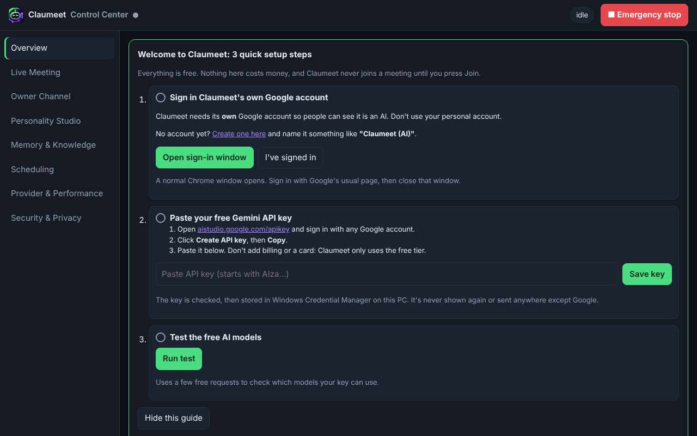

<p align="center">
  
</p>

<h1 align="center">Claumeet</h1>

<p align="center">
  <b>An open-source AI teammate for Google Meet and Zoom that always says it's an AI.</b><br>
  It talks in your meeting's language, Bangla included, and runs on your own PC using only free AI.
</p>

<p align="center">
  <a href="https://github.com/shifatbinjesun/claude-meeting-agent/releases/latest"></a>
  <a href="https://github.com/shifatbinjesun/claude-meeting-agent/actions/workflows/ci.yml"></a>
  <a href="LICENSE"></a>
  
  
</p>

<p align="center">
  <a href="https://github.com/shifatbinjesun/claude-meeting-agent/releases/latest/download/ClaumeetSetup.exe"><b>⬇ Download ClaumeetSetup.exe</b></a>
  &nbsp;·&nbsp; <a href="#install-with-claude-code">Install with Claude Code</a>
  &nbsp;·&nbsp; <a href="#is-it-safe">Is it safe?</a>
</p>

> Community project. Not affiliated with Anthropic, Google or Zoom. Voice and reasoning run on Google's Gemini API
> **free tier**. "Claumeet" is only the participant's name, and it always tells people it is an AI.

## What it does

| | |
|---|---|
| 🎥 **Google Meet and Zoom** | Paste a Meet or Zoom link and press **Join**. Claumeet opens its own Chrome window with the mic muted and the camera off. You click "Ask to join" or "Join", and the host admits it. Zoom runs in Zoom's own web client, so there's nothing extra to install. |
| 🌍 **Any language** | It replies in the language people speak to it, or you can set a default. It ships with a Bangladeshi style (Bangla, Dhakaiya, Banglish) and a neutral native style for every other language. The AI notice and "stop listening" work in 20 languages. |
| 🗣️ **Natural conversation** | Gemini Live native audio. Short answers, light humor, no talking over people. Saying "stop" or "চুপ" makes it go quiet right away. |
| ✋ **Consent first** | It hears nothing until you announce it. It posts an AI notice in chat. Anyone can say or type "stop listening" in their own language to pause it. |
| 🔐 **You stay in charge** | Only you, signed in to the local Control Center, can make it leave, mute, share or read private notes. Meeting talk can never give it new powers. |
| 🧠 **Second brain** | Local memory with separate public and private notes. Document import and sourced Wikipedia lookups. |
| 🖥️ **Control Center** | A dashboard on your own PC with a guided setup checklist. Emergency stop: **Ctrl+Shift+X**. |

<p align="center"></p>

## Install on Windows (easiest)

1. **[Download ClaumeetSetup.exe](https://github.com/shifatbinjesun/claude-meeting-agent/releases/latest/download/ClaumeetSetup.exe)** and double-click it.
   It installs for your user only, so it needs no admin rights and no drivers. If Python 3.12 or Chrome is missing, it installs them for you.
2. When the files are in place, the installer walks you through two short steps. You can skip either one and finish it later:
   - **Claumeet's Google account.** One button creates a new free Google account. Name it something like "Claumeet (AI)".
     A second button signs it in through Google's normal page. Claumeet never sees the password.
   - **Free Gemini API key.** One button opens [Google AI Studio](https://aistudio.google.com/apikey). Click
     *Create API key*, copy it and paste it into the installer. Leave billing **off**. The key is checked, then
     stored only in Windows Credential Manager.
3. The **Claumeet Control Center** opens. Paste a Google Meet or Zoom link and press **Join**.
4. Once everyone knows an AI is joining, press **Announce & start listening**.

Stop at any time with **Emergency stop** (Ctrl+Shift+X). Uninstall it from Windows **Settings → Apps**.

## Install with Claude Code

Give Claude Code this repository and ask it to install Claumeet. For example:

```text
Install Claumeet from https://github.com/shifatbinjesun/claude-meeting-agent on this PC and set it up.
```

The repository includes instructions for Claude Code
([`.claude/skills/install-claumeet`](.claude/skills/install-claumeet/SKILL.md)). Claude Code checks your PC,
runs the installer and the health check, and starts the Control Center. The private steps stay with you:
signing in the Google account and entering the Gemini key. You do those on Google's page and in
`python -m claude_agent setup`, so your key never goes into a chat.

## Other ways to install

- **One file, no exe:** download [`Setup-Claumeet.cmd`](Setup-Claumeet.cmd) and double-click it. It downloads this
  repository and runs the same installer.
- **From source (Windows):** Code → Download ZIP, extract it, then double-click **`Install-Claumeet.cmd`**. After that, use
  `Start-Claumeet.cmd`, `Stop-Claumeet.cmd`, `SignIn-Claumeet.cmd` and `Doctor-Claumeet.cmd`.
- **macOS / Linux (experimental):** `bash scripts/install.sh`, then `claumeet setup` and `claumeet run`.

## Is it safe?

No installer can honestly promise "100% safe", so here's what you can check yourself:

- **Open source and built in public.** `ClaumeetSetup.exe` is built from this code by a public
  [GitHub Actions run](.github/workflows/release.yml). The same run installs, starts and uninstalls it as a test.
- **Checksum.** Each release lists the exe's **SHA-256**. Check yours with `Get-FileHash .\ClaumeetSetup.exe` in PowerShell.
- **Not code-signed yet.** A signing certificate costs money, so Windows SmartScreen may say "Windows protected your PC".
  Click **More info → Run anyway** only if you downloaded the file from this repository's Releases page.
- **Locked libraries.** Every library is installed from a hash-pinned lock file, so a tampered package won't install.
- **Free and honest by design.** It never turns on paid APIs. It never bypasses Google or Zoom sign-in, CAPTCHAs,
  passcodes, waiting rooms or host controls. It never records audio, and your key stays in the OS credential store.

## Honest status

Tested: the safety core, memory, dashboard, installer, audio bridge and the full meeting lifecycle. The lifecycle
runs against real Chromium with **mock** Meet and Zoom pages. Not yet tried live: joining a real Google Meet or
Zoom call, Gemini Live voice quality, latency and how well each language sounds. Each one needs your accounts and
a real meeting. See [`docs/TEST_REPORT.md`](docs/TEST_REPORT.md) and [`docs/BUILD_STATUS.md`](docs/BUILD_STATUS.md).

## Docs
- [Languages](docs/LANGUAGES.md) · [Audio wiring](docs/AUDIO_WIRING.md) · [Troubleshooting](docs/TROUBLESHOOTING.md)
- [Security and threat model](docs/SECURITY.md) · [Privacy and consent templates](docs/PRIVACY.md)
- [Research and model choices](docs/RESEARCH.md) · [Implementation plan](docs/IMPLEMENTATION_PLAN.md)
- [Requirements matrix](docs/REQUIREMENTS_MATRIX.md) · [Test report](docs/TEST_REPORT.md) · [Changelog](CHANGELOG.md)

## Contributing
PRs are welcome, especially native-speaker fixes to the [translations](src/claude_agent/brain/languages.py) and
reports from live Meet or Zoom trials. Read [CONTRIBUTING.md](CONTRIBUTING.md) and [`CLAUDE.md`](CLAUDE.md) first.
Their rules on consent, security and free-only use apply to every change.

## License
MIT. See [LICENSE](LICENSE). Report security issues privately: see [SECURITY.md](SECURITY.md).
